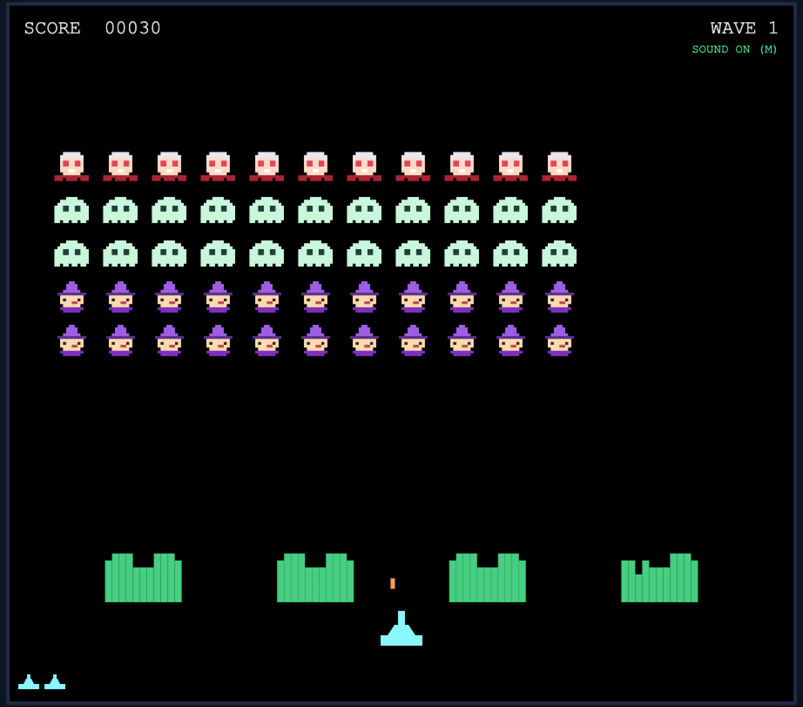

# Halloween Invaders

An arcade-style browser game inspired by Space Invaders, featuring a Halloween crew — Dracula, Ghost, and Witch — as the invading force.

## Features

- **Classic Arcade Gameplay**: Smooth, high-speed action using HTML5 Canvas.
- **Halloween Invaders (8-bit art)**: Dracula (top, 30 pts), Ghost (mid, 20 pts), Witch (bottom, 10 pts).
- **Multiple Waves**: Grids speed up each wave (and as they thin out, classic-style) — score carries over.
- **They shoot back**: Invaders return fire with a growing concurrent-bullet cap.
- **Destructible Bunkers**: 4 chisel-away shields protect your cannon; rebuilt each respawn.
- **The Mystery Ship**: A rare bonus saucer crosses the top — shoot it for a weighted 50/100/150/300 jackpot.
- **Synthesized Audio**: Real-time sound effects generated via the Web Audio API—no external audio files required.
- **Responsive Controls**: Use `A/D` or `Arrow Keys` to move, `Space` to shoot, `M` to mute.

## Installation & Running

1. **Clone the repository** (or download the files).
2. **Open the game**: Simply open `index.html` in any modern web browser.

> **Note**: The game can be opened directly from the filesystem by opening `index.html` in any modern browser. Images are loaded locally from the `assets/` directory.

## Technical Details

- **Engine**: Vanilla JavaScript and HTML5 Canvas.
- **Assets**: Images are stored locally in the `assets/` directory.
- **Audio**: Uses the Web Audio API for procedural sound generation.
